<!-- Profile README for github.com/poudelrijan123 -->

  

---

## 💜 About

I'm a student from Nepal interested in building useful software and exploring how technology can solve everyday problems.

- Learning programming through hands-on projects.
- Exploring Python, web development, AI, and hardware.
- Interested in creative technology, automation, and practical tools.
- Focused on improving one project at a time.

## ⚡ Technologies I'm exploring

## 🚀 Current interests

- Python applications and automation
- Front-end development
- AI and computer vision
- Arduino and ESP32 experiments
- Video editing and digital design

## 📸 Photography & Video Editing

I enjoy capturing moments through photography and turning ideas into engaging visual stories.

- Exploring composition, lighting, and creative photography.
- Learning video editing, transitions, and storytelling.
- Experimenting with color grading and cinematic visuals.
- Combining creativity with technology to make better content.

---

## 🐍 Contribution Activity

## 📊 GitHub Statistics

 

## 🏆 GitHub Achievements

---

### LEARN · BUILD · IMPROVE

*Building skills through curiosity and consistent practice.*

